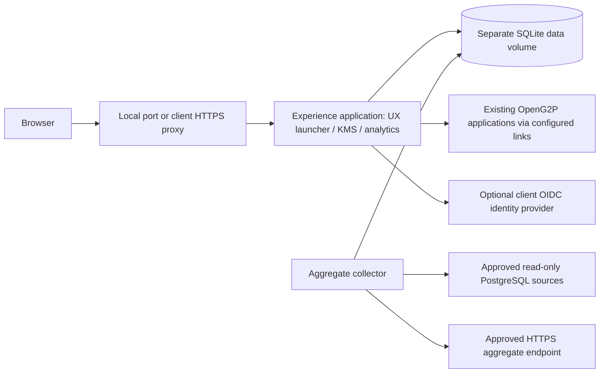

# NigeriaG2P KMS and Analytics — installation guide

**Sathvick Infotech Private Limited · 1.0.0-rc1 · 19 October 2026**

Deploy a configurable UX launcher, protected knowledge management and aggregate analytics beside an existing OpenG2P installation.

Repository: **NigeriaG2P_KMS_Analytics_Ver01** · Delivered by **Sathvick Infotech Private Limited**.

## Choose your installation

| Route | What to download | Internet requirement |
|---|---|---|
| Recommended on Intel/AMD Windows or Linux | Full Offline ZIP from [GitHub Releases](https://github.com/ssathvick/NigeriaG2P_KMS_Analytics_Ver01/releases) | Docker must already be installed; application image is included |
| Source installation | Clone this repository or download its source ZIP | First build downloads the pinned base image and Python packages |
| Apple Silicon Mac | Clone the repository and build locally | Required for the native ARM64 build |

Git source contains the application, prebuilt frontend, scripts, configuration templates and documentation. The large prebuilt container is distributed as a release asset, rather than committed to Git. The supplied offline image is **Linux/AMD64**; it is not a universal Mac image. macOS instructions are provided, but macOS runtime validation has not been performed.

## Prerequisites by platform

All platforms need a running Docker engine using **Linux containers**, Compose **2.24+**, a browser, free local port **18110**, and permission to run Docker. Git is needed only for cloning. End users do not need host Python, Node.js, PostgreSQL or a separate web server for localhost use. The KMS database is created automatically in a Docker volume.

Suggested pilot-host allocation: **2 CPU cores, 4 GB RAM available to Docker and 10 GB free disk**. This is a planning allowance, not a measured production sizing guarantee. Retain additional space for content, logs and backups. Existing OpenG2P services have their own requirements.

| Platform | Required preparation | Start command |
|---|---|---|
| Windows with Docker Desktop | A Windows version supported by current Docker Desktop, hardware virtualization, WSL2 backend, Docker Desktop started in Linux-container mode | `Start.cmd` |
| Windows with Docker Engine in WSL2 | WSL2, Ubuntu-22.04 distribution, Docker Engine and Compose installed/running inside that distribution | `Start-WSL.cmd` |
| Linux | Supported distribution, Docker Engine and Compose plugin, Bash, approved Docker operator access | `bash install.sh` |
| macOS Intel | Supported macOS, Docker Desktop for Intel started, Terminal/Bash | `bash install.sh` |
| macOS Apple Silicon | Supported macOS, Docker Desktop for Apple Silicon started; build the image locally from source | See Apple Silicon steps below |

Use the official prerequisite instructions: [Docker Desktop for Windows](https://docs.docker.com/desktop/setup/install/windows-install/), [WSL2 backend](https://docs.docker.com/desktop/features/wsl/), [Docker Engine for Linux](https://docs.docker.com/engine/install/), [Ubuntu installation](https://docs.docker.com/engine/install/ubuntu/), and [Docker Desktop for macOS](https://docs.docker.com/desktop/setup/install/mac-install/). Check the current OS/hardware requirements and applicable Docker Desktop licence before installation.

Check Docker before starting:

```sh
docker version
docker compose version
docker info
```

For the WSL-only route, run these commands inside Ubuntu-22.04. The Windows wrapper explicitly selects that distribution and uses its root Docker operator; other distribution names require running `bash install.sh` from the intended distribution instead. Do not mix Docker Desktop and a separate WSL daemon unintentionally.

## Windows installation

1. Download and extract the Full Offline release ZIP into a folder you can write to. Do not run it inside the ZIP viewer.
2. Start the Docker environment selected above.
3. Double-click **Start.cmd** for Docker Desktop, or **Start-WSL.cmd** for Docker Engine inside WSL2 Ubuntu-22.04.
4. Follow the setup prompts described below. Keep the terminal open until both services are healthy.
5. Visit **http://127.0.0.1:18110/experience/**.

For source builds, install Git and use PowerShell:

```powershell
git clone https://github.com/ssathvick/NigeriaG2P_KMS_Analytics_Ver01.git
cd NigeriaG2P_KMS_Analytics_Ver01
.\Start.cmd
# WSL-only Docker alternative: .\Start-WSL.cmd
```

The repository is public; cloning does not require GitHub authentication. A Docker permission error or port conflict must be resolved on the host before retrying; the installer does not stop existing applications.

## Linux installation

Install Docker Engine and its Compose plugin using the official instructions for your distribution. Confirm `docker info` succeeds as the approved operator. Run from a writable extracted release directory, or clone:

```sh
git clone https://github.com/ssathvick/NigeriaG2P_KMS_Analytics_Ver01.git
cd NigeriaG2P_KMS_Analytics_Ver01
bash install.sh
```

With the Full Offline ZIP, skip cloning, change into the extracted kit directory and run the same installer. It verifies/imports the TAR automatically. If your Docker policy requires elevated access, use the administrator-approved method; the scripts do not silently elevate privileges or change Docker-group membership.

## macOS installation

Install the Docker Desktop edition matching your processor and start it. Open Terminal. For an Intel Mac, clone the repository and run `bash install.sh`, or extract the Full Offline ZIP and run that script from the extracted folder. The scripts support macOS `shasum` as well as Linux `sha256sum`.

For **Apple Silicon**, prefer a native source build. Clone the repository, then run:

```sh
cd NigeriaG2P_KMS_Analytics_Ver01
docker compose build experience
bash install.sh
```

The multi-platform Python base-image index lets Docker select the native platform during this build. Do not copy the supplied AMD64 image into this native-build workflow. AMD64 emulation can be configured separately in Docker Desktop, but this release has not been tested that way. For offline ARM64 delivery, build on an online ARM64 machine and run `bash prepare-offline.sh` there; label that image package ARM64 and transfer it separately.

## What the setup wizard asks

Prepare the actual OpenG2P application URLs, your approved public HTTPS URL if remote access is needed, and either separate local editor/reviewer/publisher accounts or approved OIDC configuration. Leave an uninstalled application's URL blank to disable its link. Localhost setup is suitable for initial validation.

The installer builds or imports the image, runs first-time configuration, then starts **experience** (web application) and **collector** (scheduled aggregate reporting). It generates private `.env` settings and client JSON configuration. Re-running retains existing credentials and data. There are no default shared passwords. For later URL changes edit `config/deployment.json` and restart both services; review the integration guide for secrets and connector changes.

## Architecture and data flow



OpenG2P operational databases remain external. Only configured read-only aggregate sources are queried. KMS content, account hashes, history and usage data are held in the kit's separate SQLite store. Deploy only **one application instance**; this is not a multi-replica or HA database design. The collector shares its volume with the app.

## First-use checklist

1. Confirm launcher links reach the intended client applications.
2. Sign in with each assigned account and check role permissions.
3. Review the 54 starter drafts against actual approved SOPs. An editor submits, a different reviewer approves and a publisher publishes. Drafts are not public instructions.
4. Verify staff-only content remains restricted and approved public guidance is visible as intended.
5. Configure optional analytics sources with client-approved credentials and reconcile displayed aggregates with the source system. Empty operational analytics before configuration is expected.
6. Test a backup and restore in staging before production acceptance.

## Daily operation

Run these from the installation directory using the same Docker environment and Compose project:

```sh
docker compose ps
docker compose exec -T experience python tools/healthcheck.py
docker compose logs --tail=80 experience collector
bash backup.sh
docker compose stop collector experience
docker compose up -d --wait experience collector
```

Windows Docker Desktop also provides `Check.cmd`, `Backup.cmd` and `Stop.cmd`. WSL users can use `Backup-WSL.cmd` or run the commands inside Ubuntu from the installation folder. The named volume retains data when stopped. **Do not use `docker compose down -v` to stop the kit**: it removes the persistent volume.

Backups contain confidential content and account hashes. Keep them and generated secrets private. Restore requires both services stopped and an exact backup filename; follow [the verified restore procedure](docs/OPERATIONS.md#restore-only-this-kit). Protect Windows folders with Windows ACLs; Linux file modes alone do not secure a Windows-mounted drive.

## Client production integration

The default listener is loopback-only. Remote users need an approved HTTPS reverse proxy/ingress forwarding `/experience/` without path rewriting, the correct public base URL, DNS and certificates. OIDC requires client IdP registration, callback URLs and role mapping. Embedded contextual help requires approved native template changes and screen mapping. Configure database SELECT permissions, CA certificates and allowed reporting endpoints before enabling operational sources.

See [CLIENT-INTEGRATION.md](docs/CLIENT-INTEGRATION.md) for exact configuration and [OPERATIONS.md](docs/OPERATIONS.md) for secrets, offline delivery, upgrades, rollback and Helm installation. The Helm chart has been linted/rendered, but has not been deployed into the actual client cluster. No ingress, OpenG2P database migration or native application modification is performed automatically.

## Troubleshooting

| Symptom | Action |
|---|---|
| Docker unavailable | Start the chosen engine and verify `docker info` in that environment |
| Compose rejects `env_file` options | Upgrade to Compose 2.24 or newer |
| Port 18110 already occupied | Ask the operator to resolve the conflict; do not stop unrelated services |
| Library appears empty | Starter assets are drafts; complete independent review and publication |
| Analytics source fails | Check source version, SELECT permissions, DNS, TLS/CA and approved endpoint configuration |
| Login loops through the proxy | Confirm HTTPS public URL, forwarded headers and URI/cookie paths |
| Image fails on Apple Silicon | Build natively from source rather than loading the AMD64 release TAR |
| Private guide missing in embedded help | Use the authenticated library; cross-origin embedded help exposes public guidance only |

## Repository contents

| Path | Purpose |
|---|---|
| `app.py`, `identity.py`, `knowledge_management.py` | Web app, identity and knowledge lifecycle |
| `analytics.py`, `collector.py`, `sql/` | Aggregate reporting and read-only source profiles |
| `ui/`, `static/`, `templates/` | Frontend source, prebuilt assets and templates |
| `config/` | Default configuration and examples; generated secrets are ignored |
| `compose.yaml`, `Dockerfile`, launch scripts | Single-host installation |
| `deploy/helm/` | Single-instance Kubernetes deployment templates |
| `tools/`, `tests/` | Setup, operations helpers and application tests |
| `VALIDATION.json`, `SBOM.json`, `THIRD_PARTY_NOTICES.md` | Verification boundaries, dependency inventory and provenance |

This is a **release candidate**. Windows/WSL2 container workflows were tested; macOS and actual client SSO/schemas/ingress require validation. Scope covers the companion UX launcher, KMS and aggregate analytics; native OpenG2P forms and the Figma screen catalogue are not replaced. No additional third-party licence rights are granted by publishing this repository; retain the supplied notices.

## Install

Prerequisite: working Docker with Linux containers and Docker Compose **v2.24 or newer**. The full deployment ZIP includes a prebuilt image TAR; the installer checks its SHA256 and imports it automatically when the image is absent. The source-only ZIP needs internet for its first build. No host Python or Node.js is needed.

- **Windows with Docker in WSL2 Ubuntu-22.04:** extract this folder and double-click **Start-WSL.cmd**.
- **Windows with Docker Desktop:** double-click **Start.cmd**.
- **Linux:** run **bash install.sh** from this folder as the approved Docker operator.
- Complete the guided prompts. Open **http://127.0.0.1:18110/experience/** for localhost mode, or the configured HTTPS address after setting up the client proxy.

The first run asks for platform URLs and separate editor, reviewer and publisher credentials, or an OIDC client. There are no shared/default passwords. The installer never installs Docker or modifies the existing OpenG2P applications/databases.

## Immediately available

Configurable persona launcher, KMS draft → independent review → publication, revision history/restore/archive, public/staff permissions, a knowledge library, authenticated knowledge analytics and aggregate CSV export. The publisher account can view/export analytics. Local passwords can be changed from Account. Starter content is imported as **54 unpublished staff drafts** for local review.

## Client integration still required

Set the actual OpenG2P URLs. Add the generated help snippet to approved native templates and map screens to guidance. Operational analytics requires verified read-only source connections and matching schemas. SSO requires client IdP registration/roles. Remote users require the client's HTTPS proxy/ingress. The kit does not replace native Registry/PBMS forms or deploy the Figma design catalogue.

## Documents and controls

- [Client installation, SSO, help and analytics](docs/CLIENT-INTEGRATION.md)
- [Backups, restore, upgrades, offline and Kubernetes](docs/OPERATIONS.md)
- [Release scope and limitations](RELEASE-NOTES.md)
- [Validation results](VALIDATION.json)
- **Check.cmd**: health and collector check.
- **Backup.cmd** or **bash backup.sh**: verified knowledge database backup.
- **Stop.cmd** or **docker compose stop collector experience**: stop without deleting data.
- **Prepare-Offline.cmd** or **bash prepare-offline.sh**: build/save an image TAR on an online Docker machine.

The supplied Helm chart is for one app pod with a collector sidecar and persistent storage; see operations for client registry/secrets/ingress configuration. SQLite is single-instance; do not add replicas or use NFS.

## Verification and source

The frontend is prebuilt; source and dependency notices are included. Python runtime dependencies are pinned in requirements.lock. The official Python base-image index is digest-pinned in Dockerfile. Application tests, source privacy checks, Compose rendering and Helm validation are recorded in VALIDATION.json. Docker build/startup, HTTP workflows, TLS-enabled PostgreSQL/HTTPS fixtures and backup/restore passed under WSL2 Ubuntu-22.04. All 31 application tests passed on Windows and inside the Linux container. The client environment, actual IdP, schemas, ingress and Kubernetes runtime still require staging acceptance.

To run source tests on an engineering workstation: install requirements.lock in an isolated Python 3.12 environment, then run `python -m unittest discover -s tests -p 'test_*.py' -v` and `node tests/context.test.cjs`.

Do not include generated .env, connectors.env, Kubernetes secrets, data or backups in onward release archives. Source provenance/dependency notices are in THIRD_PARTY_NOTICES.md and SBOM.json.
